# WebX-Ray AI — System Architecture Specification

## 1. Architectural Overview

WebX-Ray AI employs a decoupled, modular client-server architecture designed for high-fidelity technical website analysis and AI blueprint reconstruction.

```mermaid
flowchart TD
    User["Developer / Quality Engineer"] --> UI["Frontend Dashboard (React + TypeScript + Tailwind)"]
    UI --> API["REST API Gateway (FastAPI)"]
    API --> Security["Security Service (SSRF Guard & Header Redaction)"]
    Security --> Engine["Browser Intelligence Engine (Playwright Headless Chromium)"]
    Security --> Crawler["Intelligent Website Crawler"]
    
    Engine --> DOM["DOM & CSSOM Extraction"]
    Engine --> Net["Network Event Capture & Schema Inference"]
    Engine --> Shot["Multi-Viewport Screenshot Capture"]
    
    DOM --> Design["Design Analyzer (Tokens Synthesis)"]
    DOM --> Comp["Component Detector (Visual Hierarchy)"]
    Net --> APIModel["API Contract Synthesizer"]
    
    Source["Owner Source Code / DDL"] --> Static["Static Source & DB Parser"]
    
    Design --> Synthesizer["AI Blueprint Engine"]
    Comp --> Synthesizer
    APIModel --> Synthesizer
    Static --> Synthesizer
    
    Synthesizer --> Prompts["Reconstruction Prompts (Claude, Gemini, Antigravity, Cursor)"]
    Synthesizer --> Bundle["Full Reconstruction ZIP Package"]
```

---

## 2. Component Subsystems

### 2.1 Backend Pipeline (`backend/app/`)
- **`config.py`**: Central Pydantic BaseSettings managing database URLs, persistent storage locations, browser timeouts, and optional AI provider credentials.
- **`database.py`**: Asynchronous SQLAlchemy 2.0 engine supporting both zero-configuration SQLite for local-first execution and PostgreSQL for enterprise deployments.
- **`models/entities.py`**: Declarative relational data models tracking Projects, ScanJobs, Pages, Snapshots, Components, Tokens, Assets, Network observations, API contracts, and Blueprints.
- **`services/security.py`**: Comprehensive SSRF protection validating DNS resolution, blocking private/loopback IPs, and redacting authorization secrets.
- **`services/browser_engine.py`**: Manages Playwright browser lifecycle, executes headless Chromium, captures multi-viewport screenshots, extracts DOM snapshots, and observes network traffic.
- **`services/crawler.py`**: URL normalization, robots.txt parsing, XML sitemap discovery, internal hyperlink recursion, and page type classification.
- **`services/design_analyzer.py`**: Synthesizes color palettes, typography hierarchies, and spacing tokens from computed CSS.
- **`services/component_detector.py`**: Analyzes bounding boxes and DOM tags to identify reusable visual components.
- **`services/blueprint_generator.py`**: Generates the standardized 15-file blueprint package and AI coding agent prompts.
- **`services/visual_verifier.py`**: Aligns screenshots, calculates SSIM similarity scores, and generates magenta difference images.
- **`services/export_service.py`**: Assembles directory structures and compresses project bundles into ZIP archives.

---

### 2.2 Frontend Client (`frontend/src/`)
- **Vite + React 18 + TypeScript**: Strict types, fast HMR, and bundle optimization.
- **Tailwind CSS Design Tokens**: Custom dark theme palette matching `#10151D` (Background), `#171F2B` (Surface), `#24C78B` (Primary), and `#A78BFA` (AI Accent).
- **Zustand Store (`useAppStore.ts`)**: Global state management for active project selection, live scan monitoring, and toast notifications.
- **TanStack Query & REST Client (`api/client.ts`)**: Clean asynchronous data fetching and cache management.
- **React Router DOM**: Declarative client-side routing across all 24 platform screens.
