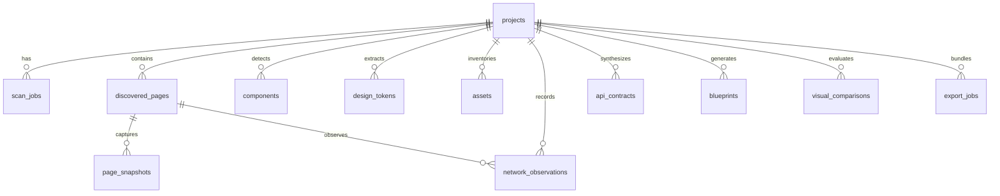

# WebX-Ray AI — Database Schema & Data Modeling

## 1. Relational Entity Overview

WebX-Ray AI utilizes SQLAlchemy 2.0 with asynchronous engine bindings. The database models capture the complete evidence index without storing large binary assets in database columns.

---

## 2. Table Specifications

### `projects`
- `id`: UUID (Primary Key)
- `name`: String(255)
- `description`: Text
- `target_url`: String(1024)
- `status`: String(50) — `idle`, `scanning`, `analyzing`, `completed`, `error`
- `access_profile`: String(50) — `public`, `test_env`, `source_repo`, `api_docs`, `db_schema`, `full`
- `auth_config`: JSON (Encrypted test login parameters)
- `source_path`: String(1024)
- `db_schema_input`: Text
- `created_at` / `updated_at`: DateTime

### `scan_jobs`
- `id`: UUID (Primary Key)
- `project_id`: Foreign Key (`projects.id`, CASCADE)
- `status`: String(50) — `queued`, `running`, `completed`, `failed`, `cancelled`
- `mode`: String(50) — `internal_links`, `sitemap`, `dynamic`, `manifest`, `source`
- `max_pages`: Integer
- `max_depth`: Integer
- `pages_discovered`: Integer
- `pages_analyzed`: Integer
- `started_at` / `completed_at`: DateTime

### `discovered_pages`
- `id`: UUID (Primary Key)
- `project_id`: Foreign Key (`projects.id`, CASCADE)
- `scan_job_id`: Foreign Key (`scan_jobs.id`, CASCADE)
- `url`: String(1024)
- `path`: String(1024)
- `title`: String(512)
- `discovery_method`: String(50)
- `http_status`: Integer
- `page_type`: String(50)
- `depth`: Integer
- `analysis_status`: String(50)
- `confidence_level`: Float
- `screenshot_path`: String(1024)

### `page_snapshots`
- `id`: UUID (Primary Key)
- `page_id`: Foreign Key (`discovered_pages.id`, CASCADE)
- `viewport`: String(50) — `desktop`, `tablet`, `mobile`
- `html_snapshot_path`: String(1024)
- `dom_tree_json`: JSON
- `computed_styles_json`: JSON
- `screenshot_path`: String(1024)
- `timing_data_json`: JSON
- `a11y_tree_json`: JSON
- `console_logs_json`: JSON

### `components`
- `id`: UUID (Primary Key)
- `project_id`: Foreign Key (`projects.id`, CASCADE)
- `name`: String(255)
- `category`: String(100)
- `bounding_box_json`: JSON (`x`, `y`, `width`, `height`)
- `visual_properties_json`: JSON
- `dom_selector`: Text
- `css_properties_json`: JSON
- `reusability_score`: Float
- `confidence_score`: Float

### `design_tokens`
- `id`: UUID (Primary Key)
- `project_id`: Foreign Key (`projects.id`, CASCADE)
- `token_type`: String(50) — `color`, `typography`, `radius`, `shadow`, `spacing`
- `name`: String(100)
- `value`: String(255)
- `category`: String(100)
- `usage_count`: Integer
- `source_evidence`: Text
- `confidence`: Float

### `api_contracts`
- `id`: UUID (Primary Key)
- `project_id`: Foreign Key (`projects.id`, CASCADE)
- `endpoint_path`: String(1024)
- `method`: String(10)
- `summary`: Text
- `request_schema_json`: JSON
- `response_schema_json`: JSON
- `status_codes_json`: JSON
- `auth_required`: Boolean
- `confidence`: Float

### `blueprints`
- `id`: UUID (Primary Key)
- `project_id`: Foreign Key (`projects.id`, CASCADE)
- `version`: Integer
- `title`: String(255)
- `complete_blueprint_md`: Text
- `website_analysis_json`: JSON
- `implementation_roadmap_md`: Text
- `testing_requirements_md`: Text
- `reconstruction_master_prompt_md`: Text
- `claude_prompt_md`: Text
- `gemini_prompt_md`: Text
- `antigravity_prompt_md`: Text
- `cursor_prompt_md`: Text
- `generic_prompt_md`: Text
